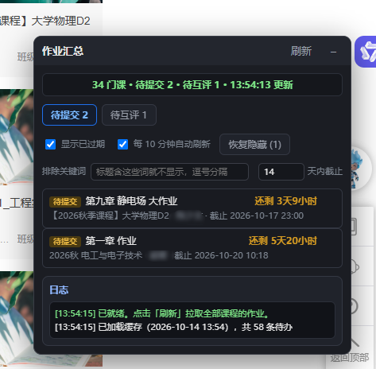

# 作业汇总助手 · 优学院

东莞理工学院（DGUT）优学院 / 强智教学平台的**作业汇总工具**：一键汇总所有课程里**最近要交的作业**和**待互评任务**，按截止时间排序并倒计时，不用再一个个点开课程网页查。提供两个版本：

| 版本 | 文件 | 特点 |
|---|---|---|
| 油猴脚本 | `作业汇总助手.user.js` | 浏览器内运行，复用已登录会话，装完即用 |
| 桌面版（Python） | `作业汇总助手.py` | 独立窗口，**账号本地加密保存、开机自动登录**，无需开着浏览器 |



## 桌面版（Python GUI）

```
pip install -r requirements.txt
py 作业汇总助手.py
```

**日常启动**：直接双击 `启动作业汇总助手.bat` 即可（无控制台黑窗口）。该批处理调用 `launch.pyw`，用 `.venv` 里的 `pythonw.exe` 无窗口运行主程序；若启动失败会弹出错误框并写 `启动错误.log`。想放桌面/任务栏：右键该批处理 → 发送到 → 桌面快捷方式。

- **登录**：输入学号密码自动登录（Windows DPAPI 加密保存在本机 `account.json`，仅当前系统账户可解）；密码登录被验证码/统一身份认证拦住时，可改粘贴浏览器里的 `AUTHORIZATION` 凭据登录
- **自动刷新**：启动时自动验证凭据 → 扫描全部课程；凭据失效自动用保存的密码重登一次；可开 10 分钟定时刷新
- **界面**：待提交 / 待互评两个标签（带计数）、截止时间、20 秒刷新的倒计时、已过期标红、1 天内标橙
- **过滤**：天数筛选（默认 14 天内、0 不限）、排除关键词（逗号分隔）、隐藏选中（Delete 键）/ 恢复隐藏、显示已过期开关
- **其他**：双击条目打开作业页、导出原始 JSON（排查状态映射用）、日志面板、退出登录、**「提醒设置…」（临期作业自动提醒，见下一节）**
- 配置存 `config.json`，窗口位置记忆；仓库里这些文件已 gitignore，**不会被提交**

测试（不联网）：

```
py -m unittest -v test_homework test_notify
```

## 临期自动提醒（不用开着程序）

主程序可以完全关掉，Windows 计划任务会在后台按时帮你盯着作业。

**怎么用**：打开主程序 → 点上方「提醒设置…」→ 按需勾选通知方式 → 点「保存并启用」。
启用后会注册一个名为 `作业汇总助手-临期提醒` 的计划任务，以当前用户身份运行，**不需要管理员权限**，也不用常驻任何进程。

### 到底需不需要一直开着程序？

**不需要。** 主界面关掉、进程一个都不留，提醒照样会来——干活的是 Windows 计划任务，到点了系统自己把 `pythonw.exe notify.py --run` 拉起来跑一次，跑完就退出。

但它也不是无条件的，下面这些情况下**不会**提醒：

| 情况 | 会不会提醒 | 说明 |
|---|---|---|
| 主界面没开 | ✅ 照常 | 计划任务跟界面没关系 |
| 电脑开着、人已登录 | ✅ 照常 | 默认每天 08:30–22:30 之间每 3 小时一次 |
| **电脑关机 / 睡眠** | ❌ 当时不提醒 | 但开了 `StartWhenAvailable`，**一开机就会补跑一次**（不会整天空着） |
| **没登录 Windows** | ❌ 不运行 | 任务是 `InteractiveToken`，只在你登录的会话里跑 |
| 免打扰时段（默认 22:30–07:30） | ❌ 静音 | 但剩余不足 2 小时的作业照常提醒 |
| 用电池（没插电源） | ✅ 照常 | 这条是特意改过的，见下 |
| 登录凭据失效 | ⚠️ 会提醒 | 发一条「无法获取作业，请重新登录」 |

> **关于电池**：`schtasks` 命令行建出来的计划任务默认带 `DisallowStartIfOnBatteries=true`，
> 也就是**笔记本一拔电源就完全不跑**——对提醒功能是致命的。本项目在注册任务后会自动用
> PowerShell 的计划任务模块把 `AllowStartIfOnBatteries` / `DontStopIfGoingOnBatteries` 打开，
> 并顺便打开 `StartWhenAvailable`（错过就补跑）。如果你手动用 `schtasks` 建过任务，记得检查这两个开关。

> 没有开 `WakeToRun`（定时唤醒睡眠中的电脑）—— 那会把合盖的笔记本叫醒，弊大于利。
> 睡眠期间错过的检查靠开机后的补跑补上。

**默认行为**（全部可在设置里改）：

| 项目 | 默认值 |
|---|---|
| 提前几天开始提醒 | 3 天 |
| 检查频率 | 每天 08:30 起，每 3 小时看一次 |
| 免打扰 | 22:30–07:30（剩余不足 2 小时仍会提醒） |
| 临近时再提醒 | 剩 24 小时 / 6 小时 / 1 小时各一次 |
| 每日汇总 | 开：每天早上把要交的作业汇总成一条通知 |
| 通知方式 | Windows 系统通知 + 邮件 |

**设置界面里的「什么时候提醒」就 5 行**，一行一件事：

```
提前     [3] 天开始提醒
检查     每天 [08:30] 起，每 [3] 小时看一次
免打扰   [22:30] 到 [07:30]   （这段时间不打扰，除非作业快截止了）
临近时   再提醒我： ☑剩 24 小时  ☑剩 6 小时  ☑剩 1 小时
汇总     ☑ 每天一次，把这段时间要交的作业汇总成一条通知
```

> 计划任务每天跑多久是**自动推算**的：从「每天几点起」一直排到「免打扰开始」（默认 08:30→22:30 就是 14 小时）。
> 原来这里有个「持续 N 小时」的输入框，但没人会去想这个概念，而且它跟免打扰时段本来就该一致，所以砍掉了。
> 同理，「免打扰期间是否还提醒」也不再暴露成选项——剩余不足 2 小时一律照常提醒，真快截止了不该被静音。

**5 种通知方式，可任意组合**：

| 方式 | 说明 |
|---|---|
| Windows 系统通知 | 右下角弹出并留在「通知中心」，人不在也能事后看到。**默认用「提醒式」通知：不点掉就一直停在屏幕上**，不会一晃眼错过。不装任何东西（走系统自带 WinRT）。**来源名显示为「周一天女仆」，图标是项目里的 `通知图标.png`**，都能在设置里改 |
| 屏幕弹窗 | 置顶窗口列出作业，双击条目直接打开作业页，可「稍后提醒(30分钟)」，默认 30 秒自动关闭 |
| 提示音 | 系统提示音 |
| 推送到手机 | **人不在电脑旁也能收到**。内置 5 个服务商，设置里选好点 **「打开配置页面 ↗」** 直接跳官网。**免费的排前面**：企业微信群机器人 / 钉钉群机器人 / 飞书群机器人（都是复制一个 Webhook 地址，完全免费、不用实名）；Server酱（免费额度有限）；PushPlus（⚠️ 现在要**实名且收费**才能发，否则返回 `code 905`）。纯 HTTP 请求，不额外装库 |
| 邮件 | 内置 QQ邮箱 / 163 / Gmail / Outlook 预设，选中就自动填好服务器和端口；点 **「获取授权码 ↗」** 直接跳到对应邮箱的配置页面。任意 SMTP 也支持（选「自定义」），SSL / STARTTLS 都有 |

**系统通知的来源名和图标怎么来的**：Windows 默认按 AUMID 显示来源，所以直接用 PowerShell 发通知会显示成「Windows PowerShell」。本项目改用一个自定义 AUMID `DGUT.HomeworkReminder`，并在注册表
`HKCU\Software\Classes\AppUserModelId\DGUT.HomeworkReminder` 的 `DisplayName` / `IconUri` 里写上「周一天女仆」和图标路径，通知来源就变成这个名字和图标。
图标会在发通知时自动复制到 `%LOCALAPPDATA%\HomeworkReminder\toast_icon.png`（纯 ASCII 路径，避免中文/空格在 toast 的 URI 里出问题），源文件是项目根目录的 `通知图标.png`（256×256，约 9 KB）。
这个注册表键在每次发通知时自动写入/校正，删掉也会自动重建；不想要了执行 `reg delete "HKCU\Software\Classes\AppUserModelId\DGUT.HomeworkReminder" /f` 即可。

想换图标：直接在设置里把「通知图标」指向任意 png/jpg。推荐先去掉白底并裁成正方形再放进来——白底图在通知里会是一块白色方块。
仓库里另附一个纯代码绘制的备用图标生成器（**平时用不到**，需要额外 `pip install pillow`）：

```
python 生成通知图标.py            # 输出 奶龙-绘制版.png，不会覆盖正在用的图标
```

**系统通知的文案是压缩过的**：Windows 通知正文只有几行、每行约 20 个字，写长了会被截断，所以系统通知每行压成 `课程·作业·剩X`：

```
周一天女仆
2 项作业临近截止
工程力学A·作业·剩12小时47分
概率论与数理统计·第三章作业·剩1天21小时
```

压缩规则：课程名去掉 `【2026秋】`、`2026` 之类前缀；作业名去掉开头的日期和 `（占总成绩2%）` 之类括号；倒计时去掉「还剩」；**不带完整截止时间**（倒计时已经说明紧迫程度）。课程名截到 8 字、作业名截到 9 字，超了加 `…`。最多列 3 条，其余折成「另有 N 项」。

邮件 / 微信 / 文件清单**不压缩**，课程、作业、剩余时间、完整截止时间、待提交/待互评计数都保留。

**没看到通知怎么办**：普通 Windows 通知只在右下角停 5～8 秒，很容易错过，所以这里默认发的是**提醒式通知**（`scenario="reminder"`）——不点掉就一直停在屏幕上。如果连这个都没看到，按 `Win + N` 打开「通知中心」，所有发过的通知都还躺在里面（本项目发出的都带「周一天女仆」这个名字和图标）。设置里可以关掉「提醒式」，改回一闪而过的普通通知。

**配置持久化**：全部存在 `notify.json`，其中邮件密码、微信 token 用 Windows DPAPI 加密（只有本机当前账户能解）；提醒记录存 `notify_state.json`，运行日志在 `提醒日志.log`。重启电脑、关机再开都不用重新配置。

**去重规则**：同一档位只提醒一次（不会反复轰炸），每日汇总每天一次，两次提醒之间至少间隔 20 分钟，已过期和已隐藏/已排除的作业不提醒。

**服务器抽风怎么办**：学校接口会间歇性返回 401 或超时（实测同一份凭据几分钟内时好时坏）。脚本会**自动重试 3 次、每次间隔 20 秒**，全部失败才判定为「无法获取作业」并发通知，避免误报。所以偶尔在日志里看到一次「读取失败（第 1/3 次）」是正常的，后面成功就不会打扰你。

**凭据失效怎么办**：提醒脚本复用主程序保存的登录凭据。如果凭据**真的**过期且本机没存密码，会发一条「无法获取作业，请打开助手重新登录」的通知（同一问题 12 小时内只提醒一次）。**建议在登录窗口勾选「记住账号密码」**，这样凭据失效时脚本能自己重新登录，提醒就不会断。

命令行（一般不用手动跑）：

```
python notify.py --status       查看当前配置和计划任务状态
python notify.py --install      注册/更新计划任务并启用
python notify.py --uninstall    删除计划任务（停用）
python notify.py --test         立刻发一条测试提醒（不联网也能演示效果）
python notify.py --reset        清空提醒记录
python notify.py --diag         自检：把「提醒功能卡在哪一步」全列出来
```

### 点「保存并启用」报「系统找不到指定的路径」？

这是 `schtasks` 报的，意思是**当前进程拿不到 Windows 计划任务服务**，跟你的配置无关。常见原因：

1. **程序是从某个终端 / 沙箱环境里启动的**（不是直接双击）。换成在资源管理器里直接双击
   `启动作业汇总助手.bat`（或 `发布\作业汇总助手.exe`）。
2. 安全软件 / 组策略限制了计划任务的创建。

跑一次自检就能确认到底是哪一步卡住：

```
python notify.py --diag
```

它会列出：临时目录、配置文件位置、schtasks 能不能用、PowerShell 计划任务模块能不能用、
本程序的任务状态、各通知通道的自检结果，并存一份 `自检报告.txt`。
（打包成 exe 后同样支持：`作业汇总助手.exe --diag`，结果用弹窗显示。）

**正常的表现**应该是：

```
系统临时目录：C:\Users\<你>\AppData\Local\Temp
schtasks：可用
PowerShell 计划任务模块：可用（共 N 个任务）
本程序的任务：已注册 · 下次运行 2026/10/11 14:30:00 · Ready
```

如果「系统临时目录」显示的是程序所在目录而不是 `%TEMP%`，就说明这个进程被限制写临时目录了，
计划任务多半也会一起失败——换个方式启动即可。

### 点「打开配置页面」弹出 Edge 的「现有实例正在以提升的权限运行」？

这是**程序被以管理员身份启动**造成的：提权进程调 `webbrowser.open()` 时浏览器会跟着继承管理员权限，
而 Edge / Chrome 拒绝在提权下运行。

**本程序完全不需要管理员权限**（计划任务是以当前用户身份注册的，不需要提权）。两种处理：

1. **推荐**：别用管理员身份运行。右键快捷方式 → 属性 → 兼容性 → 取消勾选「以管理员身份运行」；
   也别从「以管理员身份运行」的终端里启动。
2. 实在要提权运行也行：代码里已经做了兼容——检测到提权时改用 `explorer.exe <url>` 打开链接
   （explorer 跑在普通权限下，浏览器就正常了）。主界面启动时也会在日志里提示这一条。

`--diag` 的「运行权限」一行会明确告诉你是「普通用户」还是「管理员（不推荐）」。

### 点「打开配置页面」弹出 Edge 的「现有实例正在以提升的权限运行」？

**先说结论：这多半不是本程序造成的。** 这句话说的是**已经有一个以管理员权限运行的浏览器实例**卡在那儿，
普通权限的进程没法把链接交给它。常见来源：

- 从「以管理员身份运行」的资源管理器窗口里启动过 Edge / Chrome（这样启动的浏览器会继承管理员权限）
- 之前用管理员权限跑过别的程序，它帮忙开过浏览器

**处理办法**：把那个浏览器**整个关掉**（任务管理器里结束所有 `msedge.exe`），再用普通方式打开。
Edge 一般会恢复上次的标签页。

`--diag` 现在会自动检测并报出来：

```
⚠️ 检测到以管理员权限运行的浏览器：msedge.exe(PID 21624)
  → 这就是点「打开配置页面」时 Edge 弹「现有实例正在以提升的权限运行」的原因
```

本程序自己**不会**制造这种浏览器：exe 的清单是 `asInvoker`（不申请提权），
而且检测到自身提权时会改用 `explorer.exe` 打开链接，避免浏览器继承管理员权限。

## 功能

- **待提交 / 待互评 两个标签**：一键拉取全部课程的作业，分类展示
- **按截止时间升序**：最近要交的排最前，已过期标红置顶，每条带倒计时（还剩 X 天 X 小时）
- **三种过滤**：
  - 悬停条目点 **×** 手动隐藏不要的作业（本地记忆）
  - **排除关键词**：标题含指定词的一律不显示（逗号分隔）
  - **天数筛选**：只显示 N 天内截止的作业（默认 14 天，填 0 不限）
- **点击条目**直接新标签打开该课程的作业页
- 每 10 分钟自动刷新 + 本地缓存秒开 + 页面切回自动更新
- 面板可拖动、可折叠，位置记忆
- 抢不到的登录失效、单课失败都会在日志里说清楚

## 安装

1. 浏览器安装篡改猴（Tampermonkey）扩展
2. 打开 `edge://extensions`（Chrome 为 `chrome://extensions`）→ 篡改猴 → 详细信息 → **打开「允许用户脚本」开关**（新版 MV3 必开，不打开脚本静默不执行）
3. 把 `作业汇总助手.user.js` **拖进浏览器窗口**，在篡改猴安装页点「安装」
4. 打开 `lms.dgut.edu.cn` 任意页面，右下角出现「作业汇总」面板即成功

## 使用

1. 打开优学院页面（推荐 `lms.dgut.edu.cn`），点面板右上角「刷新」
2. 切「待提交」「待互评」标签查看，第一行绿色状态栏显示汇总计数和更新时间
3. 不想要的条目悬停点 ×；批量排除用「排除关键词」；太远期的调「天内截止」

## 打包发给别人（单文件 exe）

```
python 打包.py
```

打出来的 `发布\作业汇总助手.exe` 是**单文件、免装 Python** 的绿色程序（约 13 MB），
连同自动生成的 `发布\使用说明.txt` 一起发出去即可。

脚本会自己在系统临时目录建一个**一次性**构建环境装 PyInstaller，**不污染项目的 `.venv`**，
打完把 `build/`、`*.spec`、临时环境全部删掉，只留 `发布/` 里的成品。

**打包时踩过的几个坑**（改代码时别踩回去）：

| 坑 | 处理 |
|---|---|
| PyInstaller 的 onefile 会把程序解包到临时目录，`__file__` 指向那儿，退出即删 | `BASE_DIR` / `BASE` 改成 `sys.executable` 的目录，配置写在 exe 旁边 |
| 计划任务要调 `notify.py`，但打包后没有 `.py` 文件了 | `_task_command()` 打包后生成 `"<exe>" --run`，同一个 exe 兼顾界面和提醒两种身份 |
| 图标是打包进去的只读资源，不在 exe 旁边 | `resource_dir()` 返回 `sys._MEIPASS`，`default_icon_path()` 走它 |
| 无控制台 exe 里 `print` 无处可去，`--status` 会静默无输出 | `cmd_status()` 检测 `sys.stdout is None` 时改用弹窗 |
| `notify` 是在函数内部被 import 的，静态分析可能漏掉 | 加了 `main.py` 作打包入口，顶层 import 两个模块，并加 `--hidden-import` 兜底 |

**注意**：exe 的配置是**全新默认值**（只开系统通知），跟你本机 `config.json` / `notify.json` 里的设置是两套。
`发布\` 目录已被 gitignore，别把自己的账号配置一起发出去——`打包.py` 打完会检查并提醒你。

## 调试

F12 控制台可用接口：

```js
__HW_AGG__.refresh()                  // 强制刷新
__HW_AGG__.counts()                   // 当前计数
__HW_AGG__.homeworksRaw(课程id)        // 看某门课的原始作业 JSON（校准 state 用）
__HW_AGG__.coursesRaw()               // 看原始课程列表
```

有待提交的作业没显示？跑 `__HW_AGG__.homeworksRaw(课程id)` 把返回的 JSON 对一下 state 值。

## 免责

仅供个人学习使用；请求频率极低（每次打开几到几十个只读请求），不会对教务系统造成压力。使用本脚本产生的后果自负。

## License

MIT
